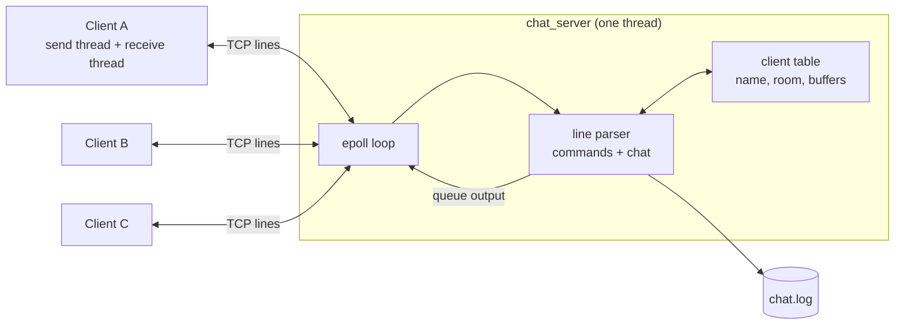
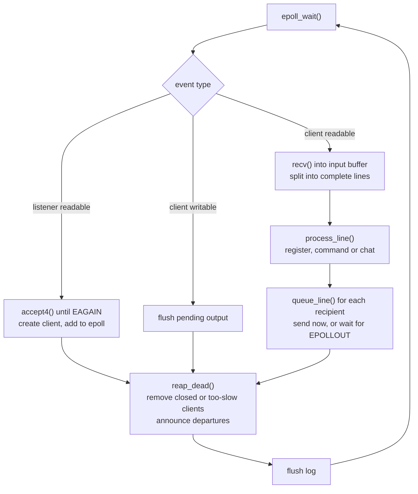
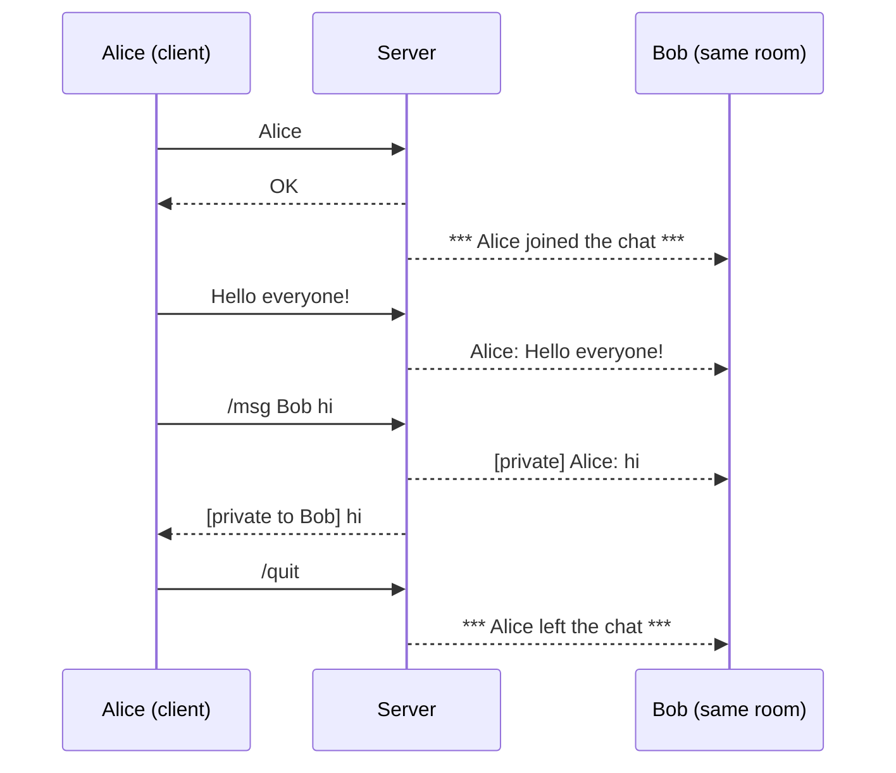

# Online Chat Server

A multi-room TCP chat server and client written in C using POSIX sockets.
The server comes in two implementations of the same protocol, so their designs can be compared directly:

- **`chat_server`**: a single-threaded **`epoll`** event loop (non-blocking I/O, no locks).
- **`chat_server_threads`**: the classic **thread-per-client** design using pthreads and a mutex.

## Features

- Many concurrent clients, broadcast chat, join/leave announcements
- Unique usernames with validation
- **Chat rooms** (`/join`, `/rooms`, `/list`) and **private messages** (`/msg`)
- Newline-delimited text protocol that handles TCP merging and splitting of messages
- Timestamped server log file (`chat.log`); private message content is never logged
- epoll server only: graceful shutdown on Ctrl+C, and **slow-client protection** (a client that stops reading is disconnected instead of stalling everyone)
- Load-test script that reports delivery loss, latency, and the server's threads, memory and CPU

## Architecture

### Overview



Clients never talk to each other. Every message goes to the server, which relays it to the right recipients.
Each client program runs two threads: one reads the keyboard and sends, the other receives and prints.

### The epoll event loop



### A typical session



## Quick start

Requires Linux or WSL2 (uses POSIX sockets and `epoll`), `gcc`, `make`, and `python3` for the load test.

```bash
make                    # builds chat_server, chat_server_threads, chat_client

./chat_server           # terminal 1: start the server (port 8080)
./chat_client           # terminal 2: enter a name, then chat
./chat_client           # terminal 3: a second user
```

Example session (Alice's terminal):

```
Enter your name: Alice
Connected to Chat Server. Type /help for commands.
You: Hello everyone!
Bob: Hi Alice!
You: /join dev
You joined #dev.
```

### Command-line options

| Program | Usage | Defaults |
|---|---|---|
| `chat_server` | `./chat_server [port] [logfile] [--quiet]` | port 8080, `chat.log`; `--quiet` silences the console |
| `chat_server_threads` | `./chat_server_threads [port] [logfile]` | port 8080, `chat.log` |
| `chat_client` | `./chat_client [server_ip] [port]` | `127.0.0.1`, 8080 |

### Chat commands

| Command | Description |
|---|---|
| `/help` | Show the command list |
| `/list` | List users in your current room |
| `/rooms` | List all rooms and how many users each has |
| `/join <room>` | Switch room (created on first use). Everyone starts in `#general` |
| `/msg <user> <text>` | Private message, works across rooms |
| `/quit` or `exit` | Leave the chat |

Names are 1-15 letters, digits or underscores, and unique ignoring case.
Room names are 1-15 letters, digits, `_` or `-`, and are case-insensitive.

## Protocol

Plain text, **one message per line, each ending in `\n`**.
TCP is a byte stream, so one `recv()` can return half a line or several lines. Both sides buffer input and only act on complete lines.

**Client to server**

1. The first line is the username. The server replies `OK`, or `ERR <reason>` (the client asks again).
2. Every later line is a chat message or a `/command`. Lines longer than 1023 characters are truncated.

**Server to client**

| Line | Meaning |
|---|---|
| `Alice: Hello` | Chat message from a user in your room |
| `[private] Alice: hi` / `[private to Bob] hi` | Private message received / sent |
| `*** Alice joined the chat ***` | A user connected (they start in `#general`) |
| `*** Alice moved to #dev ***` / `*** Alice joined #dev ***` | A user left / entered your room |
| `*** Alice left the chat ***` | A user disconnected |
| `You joined #dev.` | Reply to your own `/join` |
| `ERR ...` | The last command or name was rejected |
| `*** Server is shutting down ***` | The epoll server received Ctrl+C or SIGTERM |

### Server log

```
[2026-10-23 06:09:57] Alice moved from #general to #dev
[2026-10-23 06:09:57] Broadcast [#dev] Alice: hi dev
[2026-10-23 06:09:58] Private: Alice -> Bob
```

## Design decisions

| Decision | Reason |
|---|---|
| epoll with non-blocking sockets | One thread handles thousands of connections; no per-client stack and no context switching |
| No mutexes in the epoll server | Only one thread touches the data, so there are no races or deadlocks to reason about |
| Per-client input buffer, split on `\n` | TCP preserves no message boundaries |
| Per-client output queue + `EPOLLOUT` only while data is pending | A non-blocking `send()` can write only part of a message; polling for writability when nothing is pending would waste CPU |
| Disconnect clients with more than 256 KB of unsent output | Backpressure policy: one stalled reader must not consume unbounded memory or delay others |
| Clients are removed at the end of each loop pass (a dead list) | Prevents freeing a client while a broadcast is still iterating over it |
| Username check, claim and `OK` reply under one lock (threaded server) | Prevents two clients taking the same name, and prevents a broadcast arriving before the client's `OK` |
| Lock order is always `clients_lock` then `log_lock` (threaded server) | A fixed order prevents deadlock |
| Private message content is not logged | Only the sender and recipient are recorded |
| Log flushed once per loop pass (epoll server) | Far fewer syscalls; a crash can lose at most the last pass of log lines |

## Benchmarks

`loadtest.py` starts a server, connects N clients (grouped into rooms), sends timestamped messages, and reports delivery loss, latency percentiles, and the server's own threads, memory and CPU (read from `/proc`).

```bash
python3 loadtest.py --server ./chat_server         --clients 1000
python3 loadtest.py --server ./chat_server_threads --clients 1000
python3 loadtest.py --server ./chat_server         --clients 5000   # beyond the threaded server's 2000-client cap
```

**Environment:** _CPU model, cores, RAM, OS / WSL version

| 1,000 clients, 20 per room, 5 messages each | epoll | threads |
|---|---|---|
| Server threads | 1 | 1,001 |
| Server memory (RSS) | 5MB | 62MB |
| Latency p50 / p99 | 28.6/101.9 ms | 48.2/132.3 ms |
| Server CPU while connecting | 0.66 s | 1.14 s |
| Server CPU for the traffic  | 1.37 s | 1.35 s |
| Delivery loss | 0% | 0% |

Notes for reading the results:

- The load generator is a Python script on the same machine, so on a small machine it can become the bottleneck. Compare the **server's** CPU, memory and thread numbers, which do not depend on how fast the generator is.
- Run each test several times and report typical values.

## Testing

```bash
# memory errors and undefined behaviour (epoll server)
gcc -g -O1 -fsanitize=address,undefined chat_server.c -o chat_server_asan
# data races (threaded server)
gcc -g -pthread -fsanitize=thread chat_server_threads.c -o chat_server_tsan
```

Run a sanitizer build, then exercise it with several clients: duplicate and invalid names, messages sent in quick bursts, `/join` between rooms, a client killed with Ctrl+C, a very long line, and Ctrl+C on the server while clients are connected. Then run `loadtest.py` against it.

## Project layout

```
chat_server.c           epoll server (single thread, non-blocking)
chat_server_threads.c   thread-per-client server (kept for comparison)
chat_client.c           client: send thread + receive thread
common.h                shared protocol helpers (line reader, line sender)
loadtest.py             load generator and measurement script
Makefile                make, make bench, make clean
```

## Limitations and future work

- **Broadcast cost is O(total clients) per message.** The server scans every client to find the members of a room. Keeping a member list per room would make it O(room size).
- One thread means one CPU core. Multiple epoll workers (`SO_REUSEPORT`) would use more.
- No encryption (TLS) and no authentication; names are claimed first-come, first-served.
- Chat history is not stored for new users; the log file is for the operator.
- IPv4 only; the epoll server is Linux-only.